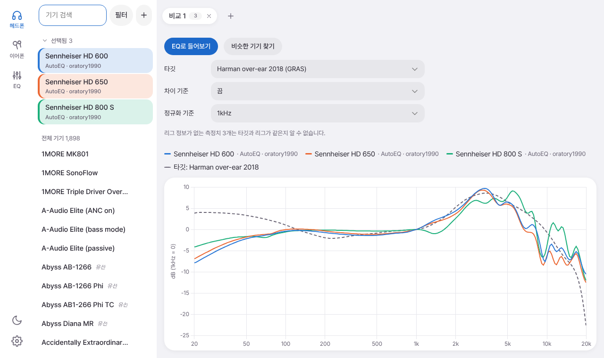
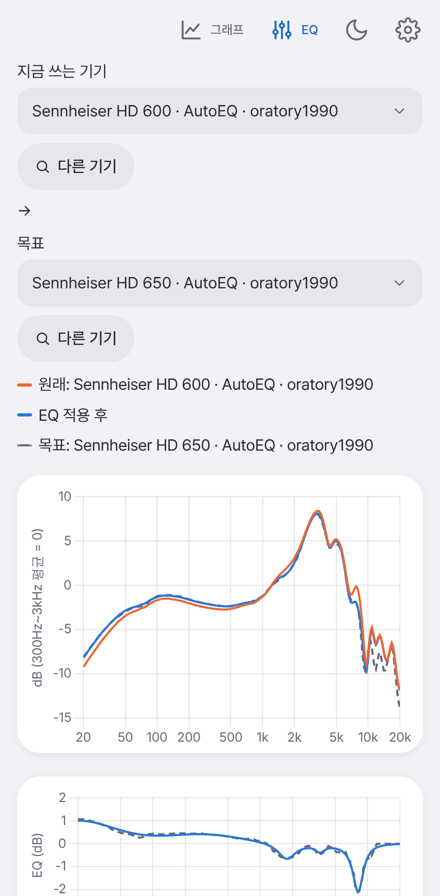

# Klang

헤드폰·이어폰의 **주파수 응답(FR) 그래프를 겹쳐 비교**하고, 소리가 비슷한 기기를 찾고, 지금 쓰는 기기에 EQ를 걸어 **다른 기기 소리를 흉내 내 보는** 개인용 앱입니다.

- 웹: **https://jindosz.github.io/audio-gear/** (PC·폰 브라우저, 홈 화면에 설치 가능)
- 안드로이드 앱: [Releases → android-latest](https://github.com/jindosz/audio-gear/releases/tag/android-latest)에서 APK 설치 — 앱 안에서 **폰 전체 소리에 EQ**를 바로 걸 수 있습니다

<p>
  
  
</p>

## 할 수 있는 것

| 기능 | 설명 |
|---|---|
| **그래프 비교** | 최대 8개 기기의 FR 곡선을 겹쳐 보기. 타깃(Harman 등) 점선, 기준 곡선과의 차이 그래프, 정규화 기준(1kHz 등) 선택. 비교 탭을 여러 개 열어 두기 |
| **전체 기기 목록** | [AutoEQ](https://github.com/jaakkopasanen/AutoEq)와 [squig.link](https://squig.link) 리뷰어 측정치를 합친 헤드폰 약 3천·이어폰 약 1만 개. 검색, 브랜드·측정자·유선/무선·ANC·오픈/밀폐 필터 |
| **내 기기 관리** | 보유·찜 표시, 특징(연결 방식·구조·코덱·ANC) 입력, 직접 잰 CSV 측정치 올리기 |
| **비슷한 기기 찾기** | 기준(기기·타깃·내 보유 기기 평균)과 곡선 거리가 가까운 순으로 추천. 저음·중고음·고음 슬라이더로 "이것보다 저음 조금 더" 같은 취향 반영. 같은 측정자 → 같은 리그 순으로 묶어 측정 환경 차이를 덜 섞음 |
| **EQ 만들기** | "지금 쓰는 기기 → 목표(다른 기기·타깃)"를 고르면 피크 필터 EQ를 자동 계산. 밴드 직접 수정, 여러 개 저장·즐겨찾기 |
| **EQ 적용** | 안드로이드 앱: **[폰에 적용]**으로 스포티파이·유튜브 뮤직 등 폰 전체 소리에 바로 적용(앱을 닫아도, 폰을 다시 켜도 유지). PC·웹: Equalizer APO·Wavelet용 파일로 내보내기 |
| **백업** | 기기·측정치·EQ를 JSON 파일로 내보내고 가져오기(PC ↔ 폰 옮기기) |

다크 모드, PC(마우스)와 폰(손가락) 화면을 모두 지원합니다.

## 설치·업데이트

### 웹
https://jindosz.github.io/audio-gear/ 를 열면 됩니다. Chrome에서는 주소창의 설치 아이콘(폰은 메뉴 → "홈 화면에 추가")으로 앱처럼 설치할 수 있고, 새 버전은 자동으로 받아집니다. 데이터는 그 브라우저 안에만 저장됩니다(서버 없음).

### 안드로이드 앱
1. 폰에서 [android-latest](https://github.com/jindosz/audio-gear/releases/tag/android-latest)의 `audio-gear-0.1.N.apk`를 받아 설치합니다("출처를 알 수 없는 앱" 허용).
2. 이후 새 버전이 나오면 **앱을 열 때 "새 버전이 나왔어요"라고 물어봅니다.** [업데이트] → 안드로이드 설치 화면에서 [설치]만 누르면 됩니다(데이터 유지). 설정 → "업데이트 확인"으로 직접 확인할 수도 있습니다.
3. 폰 전체 EQ를 쓸 때는 다른 EQ(Wavelet, 삼성 이퀄라이저·Dolby Atmos)를 꺼 두세요.

자세한 안내: [docs/android-install.md](docs/android-install.md)

## 측정치 출처

측정치는 앱에 넣어 배포하지 않습니다. 기기를 고를 때 그 측정치 하나만 원래 공개된 곳에서 받아 내 기기에 저장하고, 출처("AutoEQ · oratory1990", "squig.link · 사이트 이름")를 함께 표시합니다. 측정치의 권리는 각 측정자에게 있습니다. 측정치 재사용을 원하지 않는 곳(crinacle의 graph.hangout.audio)은 쓰지 않습니다.

## 개발

React + TypeScript + Vite, 저장은 브라우저 IndexedDB(Dexie), 그래프는 Chart.js, 안드로이드 앱은 Capacitor(폰 전체 EQ는 자바 플러그인).

```bash
npm install
npm run dev            # 개발 서버 http://localhost:5173
npm test               # 계산 함수 테스트(vitest)
npm run lint           # oxlint
npx tsc -b             # 타입 검사
npm run build          # 웹 빌드(dist/)
npm run build:android  # 안드로이드용 빌드 + android/ 동기화
```

- `main`에 푸시하면 GitHub Actions가 웹(GitHub Pages)과 정식 APK(`android-latest`)를 빌드해 올립니다. `claude/**` 작업 브랜치는 미리 보기 APK(`android-preview`).
- 주요 폴더: `src/components/`(화면), `src/*.ts`(계산·데이터, 순수 함수는 `*.test.ts` 테스트), `src/repo.ts`(DB 읽고 쓰기 창구), `android/app/src/main/java/…`(폰 전체 EQ·앱 업데이트 플러그인)
- 설계와 결정 기록: [CLAUDE.md](CLAUDE.md), `docs/superpowers/specs/`
